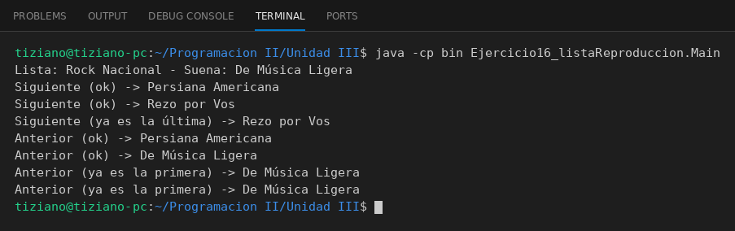

# ListaReproduccion

Programación II - Unidad 3 - Ejercicio 16

## Consigna
Modelar la clase aplicando encapsulamiento: atributos privados y métodos públicos que validan antes de modificar el estado. Una lista de reproducción que no permite salir de los límites de la lista.

## Lógica
- Lista de canciones e índice actual privados.
- `siguiente()` y `anterior()` validan los límites antes de mover el índice y devuelven `false` si no se puede.
- `obtenerPistaActual()` devuelve el nombre sin exponer la colección.
- `Main` navega superando ambos extremos.

## Ejecución

